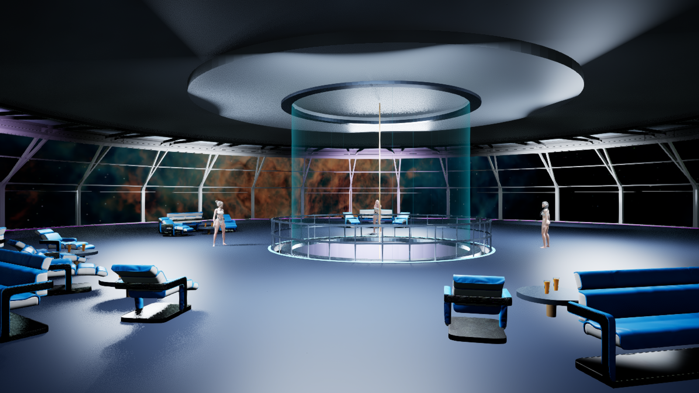
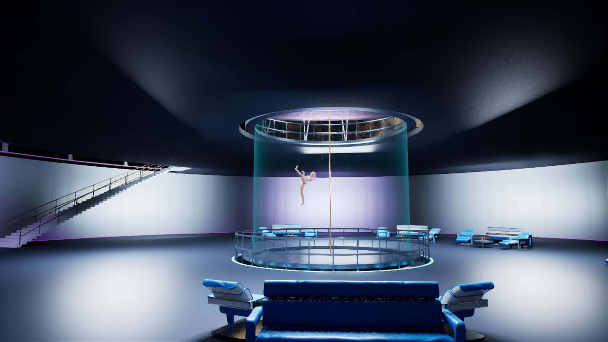
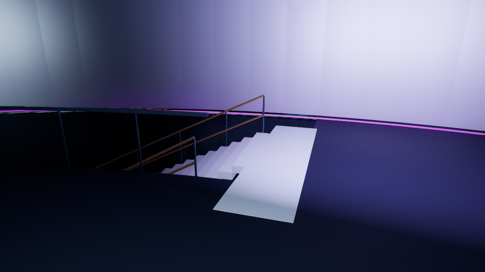
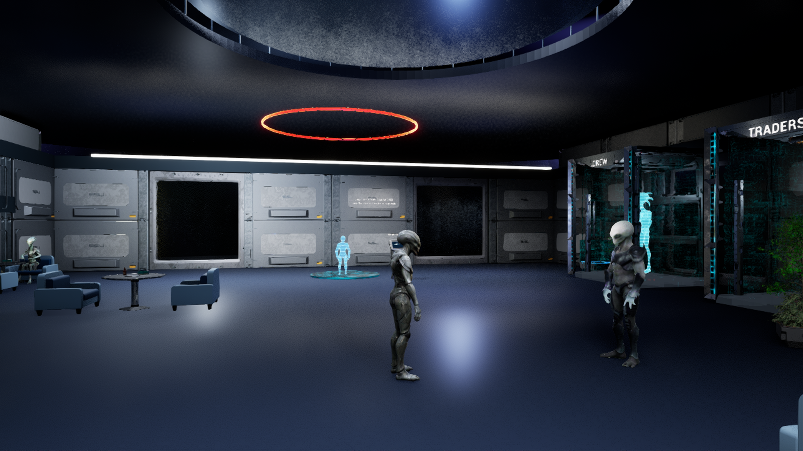

# Three-floor entertainment observatory — October 23, 2026

## Delivered scope

An isolated editable level, `/Game/SpaceSurvival/Licensed/EntertainmentObservatory/L_EntertainmentObservatory`,
implements the owner's three-floor direction. It is not a replacement of the
current station or the packaged game. The original workshop remains available.
The supplied cryo screenshot was treated as an example of failed placement;
no cryo assets were changed.

- Ground: 414 native copies of the existing crew wardrobe/performance lounge
  actors, within the circular shell. Existing geometry, furniture, art and
  service actors were copied, not rebuilt from appearance alone.
- Middle: enclosed lounge without exterior windows, with five seating groups.
- Upper: 32 Spectrum Galaxy sloped window bays and five seating groups, looking
  into the existing licensed nebula panorama. Window glass is a local material
  override; the source kit remains unchanged.
- Shared central chamber: seven-meter diameter transparent tube across both
  upper floors, pole, collars and guardrails. Vexa's preserved pink-haired
  customization uses the existing G1/G2 aerial clip. The other three original
  character instances remain upstairs.
- Two curved stairs: 40 fifteen-centimeter risers per flight, continuous
  handrails, supported landings and guards beside the floor openings.
- Overall shell: 46-meter diameter; floor elevations 0, 6 and 12 meters, roof
  at 18 meters. Twelve reusable original modules include explicit UCX hulls.

Native packages and generated source modules remain in the C-drive project.
`SourceAssets/EntertainmentObservatory/Modules/Observatory_Modules.blend` is
the compact editable architecture source. Original vendor packages and four
character sources are reused. Git stores recipes, documentation and evidence;
it is not a complete backup of the private native level.

## Verification method and defects caught

All Unreal jobs used `-RenderOffscreen`, a private user directory and layout,
`-NoAutoSave` and `-NoAssetRegistryCacheWrite`. None opened an editor window.
The map was saved, then inspected from a fresh process. Full local evidence is
in `.agent/local/Observatory_20261023`; its `Review.html` links the unedited
captures and records their camera positions.

The opposing views include each floor, both stair exits, a close window join,
the upper chamber opening and the chamber from below. Coordinates and counts
were not used as substitutes for those images. The corrective pass caught:

- Incorrect positional Rotator construction, which pitched architecture;
  explicit `yaw=` construction corrected it.
- Landing/floor overlap and a rail across an exit; corrected openings and
  landing dimensions were rechecked with collision probes.
- Disconnected horizontal stair-rail pieces; continuous sloping rails and
  posts replaced them.
- Cloudy reflective glass obscuring space; a separate clear glass override
  preserves the kit's structural materials and exposes the nebula.
- In fresh Play, a dancer auto-possessed Player 0 and Vexa fell to the chamber
  base. Review-map instance overrides disable performer auto-possession and
  gravity/movement on the aerial display. Source customization Blueprints are
  preserved. The walking pawn is explicitly checked on the repeat run.

Cross-world native copying failed twice in commandlets with an UnrealEd access
violation; the full hidden editor copied all 414 actors successfully. Material
authoring failures were corrected using reflected editor properties. These
failed receipts remain local; they are not described as passing attempts.

## Final saved-map verification

Build9 was reopened independently for Capture7 and Walk3 on October23. The
last landing close-up revealed coplanar flicker even after collision probes
passed; a 0.75cm landing lip corrected it before these final runs.

| Check | Recorded result |
|---|---|
| Saved map | 1,906 actors; SHA256 `fa62d5818cee47a7de3c527e235e91a18676e8f2b839eee8e43ce91e55ac35f4` |
| Visual review | 14 unedited 1600x900 views, including opposing floor views, both landings and window join |
| Geometry | 136 floor probes and 86 capsule-clearance probes; no reported obstruction |
| Fresh Play traversal | FirstPerson template pawn; 43/43 waypoints on each flight, all 326 movement samples walking |
| Landings | Pawn feet reach z602.34cm and z1202.15cm, including normal capsule floor clearance |
| Aerial display | Vexa remains at (0,0,930), MOVE_NONE, with single-node animation after Play begins |
| Preservation | All 20 guarded original maps/configs/saves/DLL files match; owner HEAD/index unchanged |
| Storage | 36 new native/source files, 4,689,819 bytes; vendor assets reused |

`Visual.json`, `Walk.json`, `Delivery.json` and `FinalGuards.json` contain the
full local receipts. The original station remains `56c18f66`, workshop
`8b0838d6`, and Editor DLL `70234269` (SHA256 prefixes). No C++ change or new
game binary/package was made. Python compilation, all 50 structural checks,
content-source validation and the documentation gate passed; these checks
do not replace the visual and movement evidence above.

Representative unedited captures are retained below. The full fourteen-view
gallery remains at `.agent/local/Observatory_20261023/Review.html`.

## Limits and follow-up

RPT-20261023-02 owns the layout and acceptance; RPT-20261021-01 retains original
animation, contact, clothing and hair quality work. The chamber stages an
aerial animation, not a player zero-gravity physics volume. Pole contact has
not been repaired by placing a pole. Dancer dialogue/personality and copied
crew-service bindings are not integrated into this review map's walking mode.
No full natural-input, controller, packaged, collision-fall-safety or
performance acceptance is inferred from scripted traversal and photographs.

The capture profile uses a temporary 3000MiB texture pool and 100% screen
percentage. It does not change production settings and is not a benchmark.
High-resolution stills retain temporal/lighting noise; they establish layout
and placement, not final cinematic quality. Vendor UDIM/virtual-texturing and
missing footstep-notify warnings remain, as do the earlier Parise skeletal
material usage warnings. These are retained under the character import issue.

The existing station's performance diagnosis is a separate
[saved benchmark review](2026-10-23-station-benchmark.md). Its incomplete light
sweep and summed GPU statistics do not justify blanket asset removal.

The owner can now review room proportions, window sightlines and seating, then
edit ordinary actors in this map. Station connection/migration and service
integration remain lead work after the layout is settled. Do not replay the
construction recipe after owner edits.
